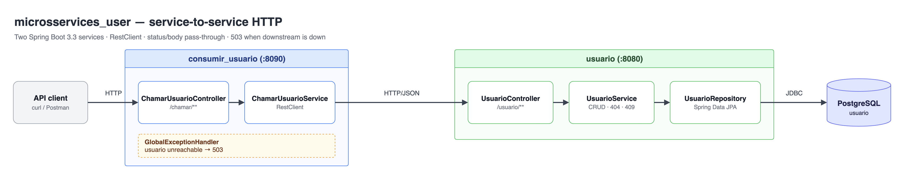

# microsservices_user — Two Spring Boot Services Talking over HTTP

Two small services that show synchronous service-to-service communication:

- **`usuario`** (port 8080) is a user CRUD service backed by PostgreSQL.
- **`consumir_usuario`** (port 8090) is a client/gateway-style service. It forwards requests to `usuario` with Spring's `RestClient` and passes the downstream **status code and body** straight through. If `usuario` is unreachable, it returns **503 Service Unavailable** with a clear message.



## Tech stack

- Java 17, Spring Boot 3.3, Spring Web (`RestClient`)
- Spring Data JPA, PostgreSQL (H2 for tests)
- MapStruct, Lombok
- JUnit 5, Mockito, MockMvc, `MockRestServiceServer`

## Endpoints

### `usuario` (http://localhost:8080)

| Method | Path | Description | Responses |
|---|---|---|---|
| POST | `/usuario/criarUsuario` | Create a user | 201 |
| GET | `/usuario/buscarUsuario/{id}` | Get a user | 200, 404 |
| PUT | `/usuario/atualizarUsuario/{id}` | Update name and/or e-mail | 200, 404, 409 (e-mail taken) |
| DELETE | `/usuario/deletarUsuario/{id}` | Delete a user | 200 |

### `consumir_usuario` (http://localhost:8090)

| Method | Path | Forwards to |
|---|---|---|
| POST | `/chamar/consumirCriarUsuario` | `POST /usuario/criarUsuario` |
| GET | `/chamar/consumirBuscarUsuario/{id}` | `GET /usuario/buscarUsuario/{id}` |
| PUT | `/chamar/consumirAtualizarUsuario/{id}` | `PUT /usuario/atualizarUsuario/{id}` |
| DELETE | `/chamar/consumirDeletarUsuario/{id}` | `DELETE /usuario/deletarUsuario/{id}` |

Every response from `usuario` (2xx, 4xx or 5xx) is returned as is. If `usuario` is down, you get:

```json
{ "status": 503, "error": "Service Unavailable", "message": "The usuario service is unavailable. Please try again later.", "timestamp": "..." }
```

## Running locally

Requirements: JDK 17+ and Docker.

```bash
# 1. Database + usuario service
cd usuario
docker compose up -d
./mvnw spring-boot:run

# 2. In another terminal: consumir_usuario
cd consumir_usuario
./mvnw spring-boot:run
```

### Configuration

| Service | Variable | Default |
|---|---|---|
| consumir_usuario | `USUARIO_SERVICE_URL` (`usuario.service.url`) | `http://localhost:8080` |
| usuario | `DB_URL` | `jdbc:postgresql://localhost:5432/usuario` |
| usuario | `DB_USERNAME` / `DB_PASSWORD` | `ADMIN` / `ADMIN` |

## Example requests

```bash
# Create through the consumer service
curl -i -X POST localhost:8090/chamar/consumirCriarUsuario \
  -H 'Content-Type: application/json' \
  -d '{"nome":"Ana","email":"ana@mail.com"}'

# Find
curl -i localhost:8090/chamar/consumirBuscarUsuario/1

# Update
curl -i -X PUT localhost:8090/chamar/consumirAtualizarUsuario/1 \
  -H 'Content-Type: application/json' \
  -d '{"nome":"Ana Maria"}'

# Not found is passed through as 404
curl -i localhost:8090/chamar/consumirBuscarUsuario/999

# Delete
curl -i -X DELETE localhost:8090/chamar/consumirDeletarUsuario/1
```

## Running the tests

Each service is a separate Maven project:

```bash
(cd usuario && ./mvnw test)
(cd consumir_usuario && ./mvnw test)
```

No Docker is needed: `usuario` tests use H2, and `consumir_usuario` tests mock the HTTP calls with `MockRestServiceServer`.
